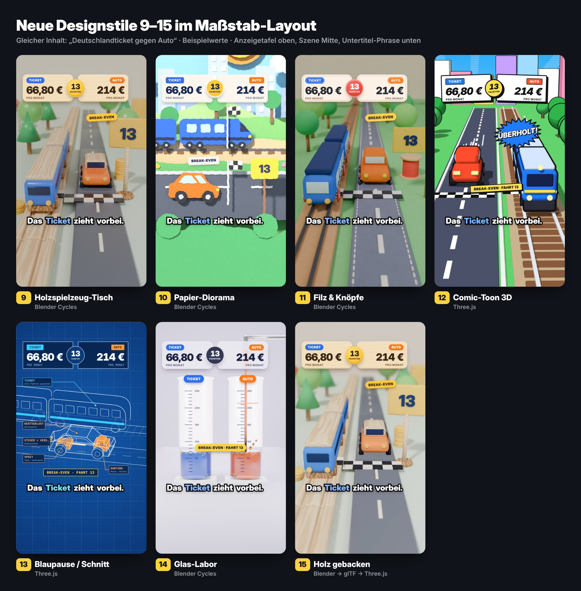
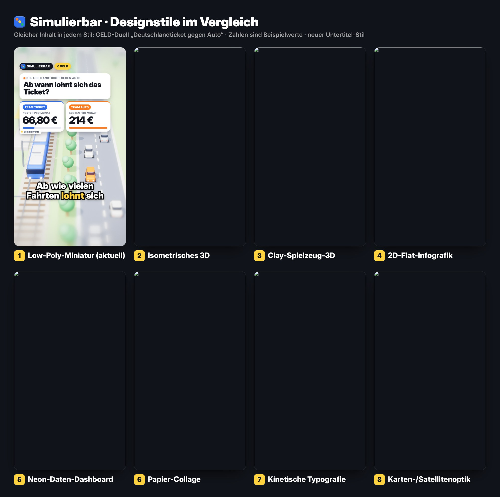
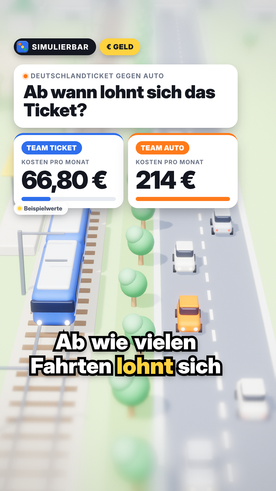
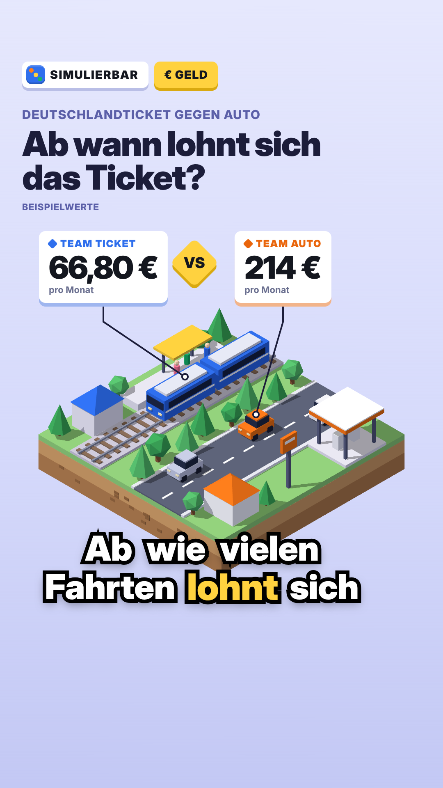
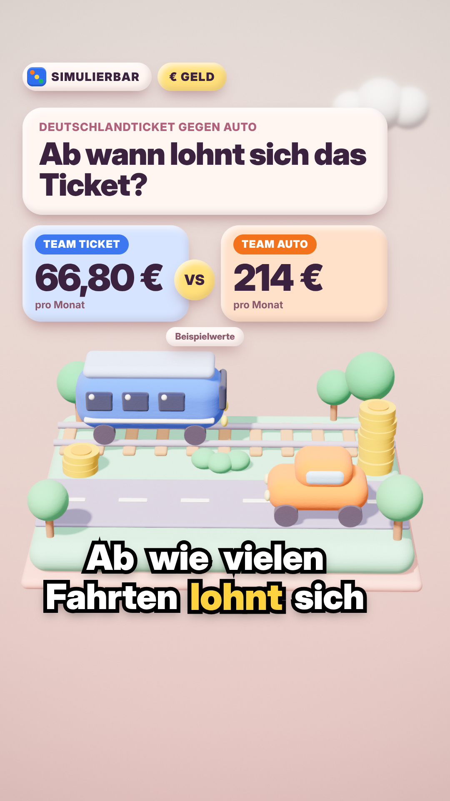
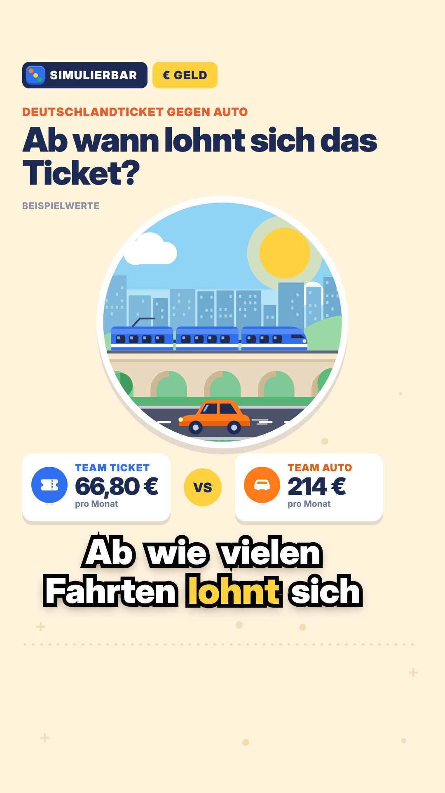
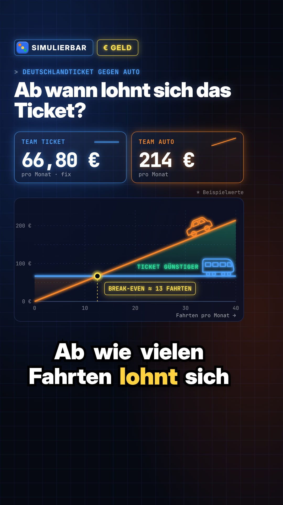
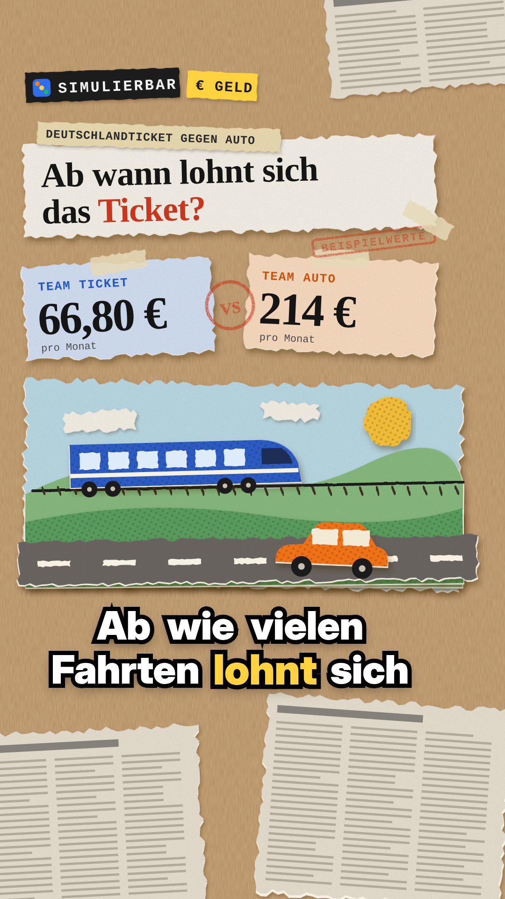
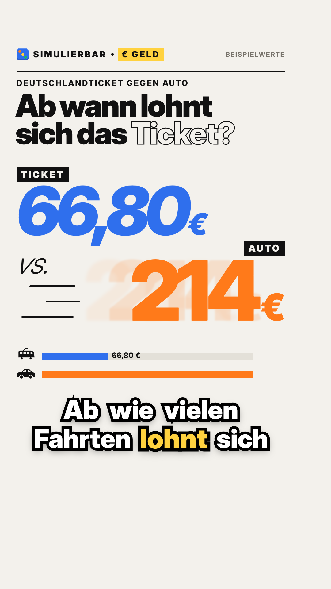
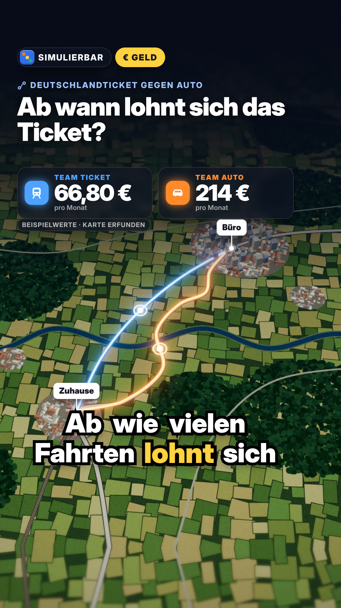

# Designstile für Simulierbar

**Stand:** 02.11.2026 · **Status:** entschieden: Stil wechselt je Thema (Abschnitt 0), **kein fester Look als Markenzeichen** (Inhaber 01.11.) · **neu 02.11.:** für Simulierbar nur noch die seriösen Stile 17–21 mit Licht und Atmosphäre (Abschnitt 0.6, Skill `.claude/skills/simulierbar-video/`); die Stile 1–15 sind als Hauptstil nicht mehr für Simulierbar erlaubt

**Legende:**
- **F** = belegter Fakt mit Quelle (bei Messungen: selbst gemessen, Datei genannt)
- **S** = Schätzung
- **A** = Annahme

Alle Beispielbilder zeigen denselben Inhalt: das GELD-Duell „Deutschlandticket gegen Auto: Ab wann lohnt sich das Ticket?“. Die Zahlen (66,80 € und 214 € pro Monat, Break-even 13 Fahrten) sind **Beispielwerte**, keine Rechnung.

> **Achtung, alte Beispielbilder 1–8:** Sie entstanden vor dem Maßstab ([15-massstab.md](15-massstab.md)). Sie zeigen teils noch Kanalname und Logo („SIMULIERBAR“ mit Würfel), die Rubrik („€ GELD“), eine große Titelkarte und den alten Karaoke-Untertitel mit gelbem aktuellem Wort. **Das gilt im Video nicht mehr.** Verbindlich ist das Maßstab-Layout: Anzeigetafel oben mit Teamfarben und Zähler, Szene in der Mitte, Untertitel als kurze Phrase (weiß, fett, schwarze Kontur, kein Kasten, Schlüsselwort in Teamfarbe), **kein Kanalname, kein Logo, keine Rubrik**. Die neuen Bilder 9–15 zeigen dieses Layout. Für die Stile 1–8 gilt beim ersten Einsatz: Szene übernehmen, HUD aus der Engine (`pipeline/engine/massstab.js`). `pipeline/stile/massstab.css` und `massstab.js` sind nur das Muster für die Stilbilder.

---

## 0. Entscheidung des Inhabers (31.10.2026): Stil-Katalog, Stil wechselt je Thema

> **Entscheidung des Inhabers (02.11.2026), gilt vor allem Folgenden:** „hier möchte ich mehr weg von dem Cartoon Clay sachen, hier müssen was seriöseres finden bei der mit licht effekten bisschen gespielt werden kann etc. das eine gewisse atmosphäre entstehen kann etc. wie gesagt hier bitte keine sticker mehr in zukunft, wirklich schau das wir so richtig hochwertige animations videos haben dabei.“
> - **Simulierbar nutzt ab 03.11. nur noch die Stile 17–21** (Nachtstadt-Miniatur, Dunkles Studio, Architekturmodell im Abendlicht, Glas & Licht, Nachtkarte; Steckbriefe, Baukästen und Messung in Abschnitt 0.6). Verbindlich für jede Produktion: Skill `.claude/skills/simulierbar-video/` (Stilwahl `stile.md`, Licht `licht-und-atmosphaere.md`).
> - **Nicht mehr für Simulierbar:** 1, 2, 3, 4, 5, 6, 8, 9, 10, 11, 12, 14, 15 (als Hauptstil). Blaupause (13) nur noch als „Warum?“-Einschub, Typografie (7) nur als HUD-Baustein. Stil 16 gehört zu Account 2.
> - Der Rest dieses Abschnitts (Auswahlregeln, Stilwahl mit Konkurrenz-Recherche, nie zweimal hintereinander) gilt weiter, jetzt innerhalb der Stile 17–21.

- **Alle Stile bleiben im Einsatz.** Jedes Video bekommt genau **einen** Stil, und zwar den, der am besten zum Thema passt. Es gibt keinen festen Hauptlook (die Empfehlung in Abschnitt 1 ist damit überholt).
- **Neue Stile kommen sofort in diesen Katalog**, sobald Claude einen weiteren passenden Stil findet: neue Zeile in der Tabelle unten, Beispielbild in `docs/assets/stile/`, Quellcode in `pipeline/stile/`.
- **Untertitel und HUD sind in allen Looks gleich aufgebaut** (Maßstab-Layout, siehe Hinweis oben). Nur das Material der Tafel passt sich dem Stil an (Holzbrett, Karton, Filzflicken, Comic-Panel, Milchglas …).
- **Neue feste Regel (Auftrag des Inhabers, 31.10.2026):** Videos entstehen **ausschließlich mit Three.js und/oder Blender**, auch kombiniert: Modelle, Materialien und Licht in Blender bauen und backen, als glTF exportieren und in Three.js animieren (Stil 15 zeigt den Weg). Das HUD (Tafel, Chips, Untertitel) bleibt HTML/CSS in der Three.js-Seite. Folge für die alten SVG/HTML-Muster 4–7: siehe Spalte „Technik“.
- **Entscheidung des Inhabers (01.11.2026): Unser Markenzeichen ist die Qualität, nicht ein bestimmter Look.**
  - Alle 15 Stile sind gleichberechtigt. Je Video gilt der Stil, der am besten zum Thema passt.
  - Die Empfehlung „Handgemachte Miniatur“ als fester Look (Abschnitt 0.4) ist abgelehnt.
- **Stilwahl je Video mit Konkurrenz-Recherche:**
  - Vor jeder Produktion sieht sich Claude erfolgreiche Videos zum Thema bzw. zu Nachbarthemen an: öffentliche TikTok-Seiten, Websuche, Konkurrenz-Monitor, und Vorbild-Videos, die der Inhaber hochlädt, vollständig wie in `docs/15`.
  - Daraus folgt: Welcher Look trägt dieses Thema am besten? Und wie heben wir uns in der Qualität ab?
  - Das Ergebnis steht kurz in `skript.json` (Feld `stil_begruendung`).
- Im 30-Tage-Plan steht der Stil je Video in der Spalte `stil` (`data/plan/30-tage.csv`).

### Stil-Katalog und Auswahlregel

Renderkosten: Sekunden je Videobild 1080×1920 im Cloud-Container (4 Kerne, ohne GPU), Standbild-Messung (F, `pipeline/stile/messung.json` und `messung_neu.json`). Ein 80-s-Video hat 2.400 Bilder.

| Nr. | Stil | Beispiel | Passt zu (Auswahlregel) | Technik | Renderkosten je Bild |
|---|---|---|---|---|---|
| 1 | Low-Poly-Miniatur (Tilt-Shift) · **nicht mehr für Simulierbar (Inhaber 02.11.)** | `assets/stile/stil_1_lowpoly.png` | Szenen mit vielen kleinen Akteuren in Bewegung: Verkehr, Straße, Menschenmengen, Stadtleben | Three.js + Bloom, Tilt-Shift, Schatten | 5,5 s (unter Last; ohne Last ca. 1–1,5 s) |
| 2 | Isometrisches 3D · **nicht mehr für Simulierbar (Inhaber 02.11.)** | `assets/stile/stil_2_isometrisch.png` | Systeme und Abläufe auf einen Blick: Büro, Kreuzung, Supermarkt, Wohnung im Schnitt, Boarding | Three.js | 0,7 s |
| 3 | Clay-Spielzeug-3D · **nicht mehr für Simulierbar (Inhaber 02.11.)** | `assets/stile/stil_3_clay.png` | Spiele, Zufall, Sport, Haushalt, Haustiere, Familie, Essen: verspielte Alltagsthemen | Three.js (Physical-Material, weiche Schatten); Upgrade: Knete in Blender (Abschnitt 0.2) | 5,5 s |
| 4 | 2D-Flat-Infografik · **nicht mehr für Simulierbar (Inhaber 02.11.)** | `assets/stile/stil_4_flat.png` | Erklär-Rechnungen mit Schritten: Netto, Steuern, Regeln, Statistik, Ablaufpläne | heute SVG/HTML → **nach neuer Regel in Three.js nachbauen** (flache Meshes, orthografische Kamera) | 0,1 s (SVG) |
| 5 | Neon-Daten-Dashboard · **nicht mehr für Simulierbar (Inhaber 02.11.)** | `assets/stile/stil_5_neon.png` | Geld über Zeit: Zinsen, Schulden, Inflation, Sparen, Preisverläufe (braucht immer Bewegung) | heute SVG + Leuchtfilter → **Three.js** (dicke Linien wie Stil 13 + Bloom) | 0,06 s (SVG) |
| 6 | Papier-Collage · **nicht mehr für Simulierbar (Inhaber 02.11.)** | `assets/stile/stil_6_collage.png` | News, Gesetze, Handel und Werbung, Debatten: Black Friday, Finanzierung, Abos, Singles Day | heute SVG + Papierfilter → **Three.js** (Flächen mit Canvas-Texturen) oder als 3D-Variante Stil 10 | 0,1 s (SVG) |
| 7 | Kinetische Typografie · **für Simulierbar nur als HUD-Baustein (Inhaber 02.11.)** | `assets/stile/stil_7_typo.png` | Eine starke Zahl oder ein Mythos: Netto-Schock, Wahrscheinlichkeits-Paradoxa, „Was kostet das in Arbeitsstunden“ | HTML/CSS; bleibt als **HUD-Baustein** in jeder Three.js-Seite erlaubt | 0,2 s |
| 8 | Karten-/Satellitenoptik · **nicht mehr für Simulierbar (Inhaber 02.11.)** | `assets/stile/stil_8_karte.png` | Orte, Wege, Regionen: Stadt gegen Land, Pendeln, Deutschland-Vergleiche, Wetter | Three.js + Bloom | 2,5 s |
| 9 | **Holzspielzeug-Tisch** · **nicht mehr für Simulierbar (Inhaber 02.11.)** | `assets/stile/stil_9_holz.png` | Verkehr und Wege als Spielzeug-Rennen, Familie, Kinder, Spiele, Haushalt; GELD-Duelle mit „Spielgeld“-Münzen | Blender Cycles (Standbild) → fürs Video **Blender → Bake → glTF → Three.js** (Stil 15) | Cycles: 194 s (48 Samples) · gebacken in Three.js: 0,9 s |
| 10 | **Papier-Diorama** · **nicht mehr für Simulierbar (Inhaber 02.11.)** | `assets/stile/stil_10_papier.png` | Seitenansicht mit zwei Bahnen (wie K1/K2), Stadt gegen Land, Wetter, Natur, Geschichten mit Szenenwechsel (Kulissen schieben) | Blender Cycles → Bake → glTF → Three.js (flache Schichten backen sehr gut) | Cycles: 133 s (48 Samples) |
| 11 | **Filz & Knöpfe** · **nicht mehr für Simulierbar (Inhaber 02.11.)** | `assets/stile/stil_11_filz.png` | Zuhause, Heizen, Strom, Schlaf, Winter, **Weihnachten** (Weihnachtsgeld 20.–28.11.), Kinder und Familie | Blender Cycles (Faserglanz) → Bake → glTF → Three.js | Cycles: 288 s (48 Samples) |
| 12 | **Comic-Toon 3D** · **nicht mehr für Simulierbar (Inhaber 02.11.)** | `assets/stile/stil_12_comic.png` | Schnelle Rennen mit Action: Verkehr, Sport, Wettläufe, Mythen; Sticker „ÜBERHOLT!“ passt perfekt | Three.js (Cel-Shading 3 Stufen, Rasterpunkte, Konturen) | 0,5 s |
| 13 | **Blaupause / Schnittmodell** · **für Simulierbar nur als „Warum?“-Einschub (Inhaber 02.11.)** | `assets/stile/stil_13_blaupause.png` | „Warum?“-Aufschlüsselung, Technik, Energie, Autokosten, Geräte im Querschnitt; auch als **Szenenwechsel-Baustein** in jedem Stil | Three.js (dicke Linien, verdeckte Kanten gestrichelt, Röntgen-Füllung) | 0,2 s |
| 14 | **Glas-Labor (Füllstand)** · **nicht mehr für Simulierbar (Inhaber 02.11.)** | `assets/stile/stil_14_glas.png` | Alles, was sich ansammelt: Kosten pro Fahrt, Wasser, Strom, Sprit, Zeit; Füllstand-Rennen | Blender Cycles (dünnwandiges Glas, Flüssigkeit mit Subsurface); Three.js mit `transmission` als schnellere, schwächere Variante | Cycles: 299 s (56 Samples) |
| 15 | **Holz gebacken** (Technik-Muster zu 9) · **nicht mehr für Simulierbar (Inhaber 02.11.)** | `assets/stile/stil_15_holz_gltf.png` | wie 9; zeigt den Produktionsweg für alle Blender-Stile | Blender (Cycles-Bake) → glTF → Three.js | einmalig Backen 5,5 Min., danach 0,9 s (ohne Unschärfe 0,5 s) |
| 16 | **Lunar-POV (nur Account 2 @stelldirvor.pov)** | Demo-Standbilder nur im Container (`pipeline/out/_demo-lunar-pov/standbilder/`) | Fester Look für Account 2 nach den 4 Referenzvideos des Inhabers (02.11.): Low-Poly-Welt aus fester Ich-Perspektive, Dunst, Sonne mit Bloom, Serifen-Typo; **nicht für Simulierbar** | Three.js (`engine/stil_lunar_pov.js`, `engine/lunar_hud.js`), Skill `.claude/skills/stelldirvor-video/` | 2,5–3,1 s/Bild effektiv mit 2 Workern |
| 17 | **Nachtstadt-Miniatur** (Simulierbar, 02.11.) | Demo `projekte/_demo-simulierbar/?stil=nachtstadt` (Standbilder nur im Container) | Stadtmodell zur blauen Stunde nach Regen: Auto, Taxi, Parken, Tanken, Pendeln in der Stadt, Lieferdienst, E-Bike, Einkaufsstraße, Nachtschicht | Three.js (`sim_atmosphaere.js` + `stil_nachtstadt.js`): Fassaden-Atlas, Laternen mit Kegel, nasser Asphalt mit Spiegelung, Lichtspuren, Tilt-Shift | MESS17 |
| 18 | **Dunkles Studio (Produktlicht)** (Simulierbar, 02.11.) | Demo `?stil=studio` | Geld als echtes Objekt im schwarzen Studio: Gehalt, Prämie, Schulden, Kredit, Steuer, Versicherung, Rabatt, Produkte | Three.js (`stil_studio.js`): Münzen mit Rändelung, Scheinbündel, Balkenwaage, Sockel mit LED-Kante, Softbox-Streiflicht, Spiegelboden, Lichtstrahlen, Tiefenschärfe | MESS18 |
| 19 | **Architekturmodell (Abendlicht)** (Simulierbar, 02.11.) | Demo `?stil=architektur` | Wohnen und Haushalt, Miete, Umzug, Heizen, Büro, Familie, Urlaub: weißes Modell, Gegenlicht-Sonne, Lichtstrahlen, Schnitt-Haus, Acryl-Marker in Teamfarbe | Three.js (`stil_architektur.js`) | MESS19 |
| 20 | **Glas & Licht** (Simulierbar, 02.11.) | Demo `?stil=lichtlabor` | alles, was sich ansammelt: Kaffee, Wasser, Strom, Rente, Sparen, Abos: Dunkelfeld-Glas, leuchtende Flüssigkeit als Zähler, Kaustik, Spiegelbank | Three.js (`stil_lichtlabor.js`), Glas ohne `transmission` | MESS20 |
| 21 | **Nachtkarte** (Simulierbar, 02.11.) | Demo `?stil=nachtkarte` | Orte und Wege: Pendeln, Jobangebot in zwei Städten, Fahrgemeinschaft, Bahn oder Auto, Reisen: Relief im Mondlicht, Lichtteppiche, Routen mit Lichtkopf, Wolken | Three.js (`stil_nachtkarte.js`) | MESS21 |

**Regeln bei der Wahl:**
- Zwei direkt aufeinanderfolgende Videos haben nie denselben Stil.
- Passen zwei Stile, gewinnt der, der länger nicht dran war.
- Typografie (7) darf als Baustein für Hook und Ergebnis in jedem Stil auftauchen. **Blaupause (13) darf als Szenenwechsel für „Warum?“ in jedem Stil auftauchen** (wie der Querschnitt in K3).
- Die Material-Stile 9, 10, 11 (und später Knete als Upgrade von 3) sind normale Katalog-Stile wie alle anderen. Sie werden gewählt, wenn sie zum Thema passen. Ein fester Look ist abgelehnt (Inhaber 01.11.).
- Jeder Stil braucht beim ersten Einsatz einen eigenen Szenen-Baukasten auf Basis der Beispielbilder in `pipeline/stile/` (**Schätzung:** 3–6 Std. Agentenarbeit je Stil, Blender-Stile mit Bake-Weg 5–8 Std.). Danach ist er wiederverwendbar.

**Fertige Produktions-Baukästen (Stand 01.11.2026):**

| Stil | Baukasten | Erster Einsatz | Gemessen (Cloud, ohne GPU) |
|---|---|---|---|
| 12 Comic-Toon 3D | `pipeline/engine/stil_comic.js` (Cel-Shading, Konturen, Strahlenkranz, eigene Bühne mit den Übergängen aus `kern.js`) | „Treppe oder Aufzug“ (01.11.) | 1,17 s/Bild effektiv mit 2 Workern |
| 13 Blaupause | `pipeline/engine/stil_blaupause.js` (Papier-Raster, dicke Kanten, gestrichelte verdeckte Kanten) | „Warum?“-Szene in „Treppe oder Aufzug“ | im Comic-Video enthalten |
| 14 Glas-Labor | `pipeline/engine/stil_glas.js` (Studio-Hohlkehle, Messzylinder als Live-Zähler, Zulauf, Ablaufhahn, Becherglas mit Schichten) | „200 € oder 100 € steuerfrei“ (01.11.) | 3,35 s/Bild effektiv (110,7 Min. für 66 s) |
| 4 2D-Flat-Infografik (neu in Three.js) | `pipeline/engine/stil_flat.js` (flache Meshes ohne Licht, exakte Farben, orthografische Kamera in Pixeln, Parallax-Ebenen, Flat-Schatten; Bausteine: Zimmer mit Fenster-Himmel Abendrot → Nacht, Figur in Rückenansicht, Wanduhr, Monitor, Laptop, Münzen und Münzstapel, Belege, Haus, Bürohaus, Auto, Pflanze, Hängelampe, Deko-Punkte; Bühne = Comic-Bühne ohne ACES) | „Steuererklärung oder Überstunden“ (02.11.) | ca. 0,65–0,75 s/Bild effektiv mit 2 Workern (ca. 22–25 Min. für 68 s) |
| 1 Low-Poly-Miniatur (Tilt-Shift, Stadt) | `pipeline/engine/stil_lowpoly.js` mit `kern.js`, `bausteine.js` (Fußgänger mit Gelenken: Gehen, Drücken, Warten; Fußgänger- und Kfz-Signale mit Leuchtlinsen und Ampelmännchen; Anforderungstaster mit „Signal kommt“-Feld; Querstraße mit Furt, Haltlinien, Spuren; Straßenbahn mit Türen; Autoströme mit Rückstau an der Haltlinie, vorberechnet; Laterne; Tilt-Shift-Fokus aus einem 3D-Punkt) | „Fußgängerampel: Bringt mehrmaliges Drücken etwas?“ (02.11.) | ca. 3,8 s/Bild effektiv mit 2 Workern bei MSAA 4 und Schatten 2048 (ca. 125 Min. für 66 s; Probebilder ohne MSAA ca. 3 s/Bild) |
| 16 Lunar-POV (nur Account 2) | `pipeline/engine/stil_lunar_pov.js` + `lunar_hud.js` + `stil_lunar_pov.css` (Höhennebel, Himmel, Rauch/Asche/Staubwand, Partikel, Trümmer, Statisten, Geländer, POV-Kamera, Farbphasen, drei Textebenen, Glasriss, Abspann), Ton `pipeline/atmo.py` | Demo „Vulkan gegenüber“ (02.11., nicht gepostet) | 2,5–3,1 s/Bild effektiv mit 2 Workern (Demo, Schatten 2048, Tiefenpuffer) |
| 3 Clay-Spielzeug-3D (Knete) | `pipeline/engine/stil_clay.js` mit `kern.js` und `licht.js` (Knete-Material mit Fingerabdruck-Bump, Hände für Stein, Papier und Schere stufenlos mischbar mit Pumpen und Reveal, Sockel, Schach-Bauer, Würfel, Kopf-Figur ohne Gesicht, Brett mit 10×10 Mulden und Kacheln inkl. Sortier-Animation in Farbblöcke, Wand mit Tapetenpunkten, Tisch; Hände und Brett stehen so, dass die Maßstab-HUD-Zonen frei bleiben) | „Schere, Stein, Papier: Gibt es eine Gewinnstrategie?“ (03.11. mittags) | ca. 3 s/Bild ohne Last bei MSAA 0 und Schatten 1024 (FXAA genügt), mit MSAA 4 und Schatten 2048 ca. 5 s |
| 6 Papier-Collage (neu in Three.js) | `pipeline/engine/stil_collage.js` (Packpapier-Grund mit Faser, Papierstücke mit gerissenem Rand, weißem Saum und weichem Papierschatten, Rasterpunkte, Zeitungsdruck, Klebeband, Schreibmaschinen-Etiketten, Wellpappe-Boden; Bausteine: Münzsäulen aus Papierscheiben (Höhe = Euro, unten Geld, oben Zeit), Abreißkalender mit wegfliegenden Blättern, Papieruhr, Papierfiguren ohne Gesicht (Stop-Motion-Wippen mit 12 Bildern je Sekunde), Topf mit Dampf, Lieferbeutel, Kantinen-Tablett, Einkaufstüte, Schwamm; Bühne = Comic-Bühne ohne Licht; HUD als Papierschnipsel über `projekte/mittagessen-job/stil.css`) | „Mittagessen im Job: Selbst kochen oder bestellen“ (03.11. abend) | ca. 2,4 s/Bild effektiv mit 2 Workern bei MSAA 4 (ohne Fremdlast; unter Fremdlast 3–11 s/Bild) |
| 17–21 seriöse Simulierbar-Stile (02.11.) | `pipeline/engine/sim_atmosphaere.js` (`SimBuehne` = kern.js + Lichtstrahlen + Grading, Licht-Rigs, Umgebungen für Spiegelungen, Lichtkegel, Lichtbahnen, Lichtflecke, Bodennebel, Staub, Spiegelboden, Tiefenschärfe-Helfer, `buendeln` für Draw-Calls) mit `stil_nachtstadt.js`, `stil_studio.js`, `stil_architektur.js`, `stil_lichtlabor.js`, `stil_nachtkarte.js`; HUD-Thema `sim_hud.css`; Demo `projekte/_demo-simulierbar/` | Mittagessen im Job (03.11. abend, Stil 19) bzw. Auto oder Taxi (03.11. mittag, Stil 17) | Demo-Messung in Abschnitt 0.6 |

### 0.1 Neue Stile 9–15: Steckbriefe

Gemeinsam: Maßstab-HUD aus `pipeline/stile/massstab.css` und `massstab.js` (Tafel mit Teamfarben und Zähler „13 Fahrten“, Chip „Break-even“, Phrase „Das **Ticket** zieht vorbei.“), Teamfarben Blau (Ticket) gegen Orange (Auto). Alle Modelle, Materialien und Texturen sind im Code erzeugt (prozedural), keine fremden Assets, keine Marken.

9. **Holzspielzeug-Tisch** (`stil_9_holz.py` + `.html`)
   - Look: Buche mit Maserung, lackierte Teamfarben, Holzschienen mit Rillen, Spielgeld-Münzen, Schild „13“, mintfarbener Spieltisch, warmes Fensterlicht, starke Schärfentiefe.
   - Stärke: sofort lesbar, warm, „anfassbar“, wirkt hochwertig wie Produktfotografie (A). Rennbahn kommt auf den Zuschauer zu: ideal für Duelle.
   - Schwäche: echte Holzoptik nur mit Pfadverfolgung (Cycles) bzw. gebacken; reines Three.js-Holz wirkt flacher (A).
10. **Papier-Diorama** (`stil_10_papier.py` + `.html`)
    - Look: Kartonschichten wie im Schaukasten (Himmel, Stadt, Hügel, Gleis, Straße, Vordergrund), echte Schatten zwischen den Lagen, leicht zittrige Schnittkanten, Papierfaser.
    - Stärke: Seitenansicht mit zwei Bahnen ist exakt das K1/K2-Rennschema, aber in Material statt 2D-Flat (A). Szenenwechsel wie im Theater: Kulissen schieben sich ins Bild.
    - Schwäche: Seitenansicht ohne Kamerafahrt in die Tiefe; Dynamik kommt aus Parallaxe, Zählern und Kulissenwechseln (A).
11. **Filz & Knöpfe** (`stil_11_filz.py` + `.html`)
    - Look: gepolsterte Filzformen mit Faserglanz, Ziernähte, Knöpfe als Räder, Bommel-Bäume, Garnrolle, Filzfähnchen „13“, Tafel als Filzflicken mit Naht.
    - Stärke: gemütlich, saisonal (Winter, Weihnachten), sehr eigen (A).
    - Schwäche: neben Glas der teuerste Look (Faserglanz und Struktur brauchen Samples). Die Faser muss als Farbkörnung im Material liegen, sonst glättet der Denoiser sie weg (F, Test). Echte Fusseln nur mit Haar-Partikeln (noch teurer). Für viele Objekte zu unruhig (A).
12. **Comic-Toon 3D** (`stil_12_comic.html` + `.js`)
    - Look: Cel-Shading in 3 Stufen, Rasterpunkte (Halftone) in den Schatten, schwarze Konturen, harte Schatten, Strahlenkranz-Himmel, Tempostriche, Sticker „ÜBERHOLT!“, schräge Comic-Panels als Tafel.
    - Stärke: maximal lesbar und energiegeladen, rendert schnell, keine Nachbearbeitung nötig (F, Messung). Bausteine aus dem Maßstab (Sticker, Chips) passen nahtlos.
    - Schwäche: weniger „edel“ als die Material-Stile; Comic-Optik ist bekannt (Spider-Verse-Welle), aber im deutschen Simulations-Genre nicht verbreitet (A).
13. **Blaupause / Schnittmodell** (`stil_13_blaupause.html` + `.js`)
    - Look: technische Zeichnung auf Blaupausen-Raster, dicke weiße Kanten, verdeckte Kanten gestrichelt, Auto als Röntgen-Schnitt mit Kostenteilen in Teamfarbe (Sprit, Wartung, Wertverlust, Steuer + Versicherung) und Führungslinien.
    - Stärke: macht die „Warum?“-Aufschlüsselung sichtbar (Maßstab-Gesetz 8). Schnellster neuer Stil (F, Messung).
    - Schwäche: allein zu kühl für ein ganzes Video; am besten als Szenenwechsel (A).
14. **Glas-Labor** (`stil_14_glas.py` + `.html`)
    - Look: zwei Messzylinder aus dünnem Laborglas im Fotostudio (Hohlkehle, Softboxen), Geld als farbige Flüssigkeit, Zulauf mit Strahl und Tropfen über dem Auto-Zylinder, gelbe Gleichstand-Linie, Zielstrich „214“, Teamchips auf den Zylindern, Milchglas-Tafel.
    - Stärke: Füllstand ist ein Live-Zähler, den jeder ohne Erklärung versteht; erinnert an K4 (Messzylinder), aber fotorealistisch statt 2.5D (A).
    - Schwäche: Glas und durchscheinende Flüssigkeit sind blickabhängig und lassen sich nicht backen. Fürs Video: Three.js-`transmission` bzw. halbtransparente Flüssigkeit mit gebackener Umgebung (S). Echte dicke Glaswände (Brechung) wurden in Cycles schwarz bzw. unruhig; dünnwandiges Glas (`Thin Wall`) ist sauberer und schneller (F, Test).
15. **Holz gebacken: Blender → glTF → Three.js** (`stil_15_holz_gltf.py` + `.html`/`.js`)
    - Weg: Szene aus Stil 9 bauen → Licht in Texturen backen (Cycles, diffus: direkt + indirekt + Farbe) → eine `.glb`-Datei → Three.js zeigt sie mit unbeleuchteten Materialien, AgX-Tonemapping wie Blender und einer günstigen Tiefenunschärfe (Abstand je Pixel, Weichzeichner in halber und viertel Auflösung, Stärke aus Brennweite und Blende der Blender-Kamera). Der fertige `BokehPass` von Three.js kostete unter Last 2,6–3 s je Bild (F, Messung) und wurde deshalb ersetzt.
    - Regeln: Tisch und Kulisse **ohne** Fahrzeuge backen, Fahrzeuge einzeln backen und mit mitfahrendem Kontaktschatten bewegen; Glanz wird nicht gebacken.
    - Ergebnis: Das Bild ist dem Cycles-Bild 9 sehr nah (A, eigener Bildvergleich). Unterschiede: kein Glanz auf dem Lack, Farben etwas flauer (der AgX-„Punchy“-Look fehlt in Three.js), Kontaktschatten der Fahrzeuge weicher. Zug und Auto lassen sich per `renderAt(t)` verschieben (Beweis der Animierbarkeit).
    - Fallstrick (behoben): `gltf.scene` ist in Three.js nur eine Gruppe. `overrideMaterial` und `background` wirken erst, wenn sie in eine echte `THREE.Scene` gehängt wird.

### 0.2 Bewertung aller geprüften Kandidaten (Recherche 31.10./01.11.2026)

Punkte 1 (schlecht) bis 5 (gut), alle **Schätzungen (S)** auf Basis der Beispielbilder, der Messungen und der Quellen in 0.5. „Render“: 5 = schnell im Produktionsweg (bei Blender-Stilen: gebacken). „Aufwand“: 5 = wenig Arbeit für einen wiederverwendbaren Baukasten.

| Kandidat | Handy-Lesbarkeit | Maßstab-Bausteine (Tafel, Zähler, Chips, Rennen mit Uhr) | Dynamik | Render | Abhebung von 2D-Flat und Low-Poly | Aufwand | Summe | Ergebnis |
|---|---|---|---|---|---|---|---|---|
| Comic-Toon mit Konturen und Rasterpunkten | 5 | 5 | 5 | 5 | 4 | 4 | **28** | **Stil 12** |
| Holzspielzeug | 5 | 4 | 4 | 4 | 5 | 4 | **26** | **Stil 9** (+ 15) |
| Blaupause / Röntgen-Querschnitt | 4 | 5 | 3 | 5 | 5 | 4 | **26** | **Stil 13** |
| Papier-Diorama / Papercraft | 5 | 4 | 3 | 4 | 5 | 4 | **25** | **Stil 10** |
| 3D-Datenraum (Infografik im Raum) | 4 | 5 | 4 | 5 | 3 | 4 | 25 | als Baustein in 5 und 13, kein eigener Stil (zu nah an Neon und Bar-Chart-Races) |
| Filz / Stoff | 4 | 4 | 3 | 3 | 5 | 3 | **22** | **Stil 11** (saisonal) |
| Glas-Labor (Glas als Szene) | 4 | 4 | 4 | 2 | 4 | 3 | **21** | **Stil 14** |
| Frosted-Glass-UI über 3D | 4 | 5 | 3 | 4 | 2 | 5 | 23 | nur als HUD-Variante (Tafel in Stil 14), kein Szenenstil |
| Pastell-Isometrie à la „Monument Valley“ | 4 | 3 | 3 | 5 | 2 | 4 | 21 | nein: zu nah an Stil 2 und am Pastell-Look von K3, Kopie-Risiko |
| Synthwave-Nacht | 4 | 4 | 4 | 3 | 2 | 4 | 21 | nein: Trend von 2018–2020, nah an Stil 5 (A) |
| Knete / Claymation (Blender, SSS, Fingerabdrücke) | 4 | 4 | 4 | 2 | 3 | 3 | 20 | später als **Upgrade von Stil 3** (gleiche Familie wie 9–11), kein neuer Stil |
| Baustein-Optik (Klemmbausteine) | 4 | 4 | 4 | 3 | 2 | 3 | 20 | nein: sehr verbreitet (Brickfilms), Markennähe; Form des Steins ist zwar nicht markengeschützt, die Figuren schon (F, EuGH C-48/09 P und EuG zu Minifiguren) |
| Voxel | 3 | 3 | 4 | 5 | 1 | 4 | 20 | nein: wirkt wie Spielegrafik, verschärft die „Video Games“-Einordnung (F: 4 von 6 3D-Videos so eingeordnet, [01-marktanalyse.md](01-marktanalyse.md)) |
| Miniatur-Modelleisenbahn (realistisch) | 3 | 4 | 4 | 2 | 3 | 2 | 18 | nein: feine Details auf dem Handy unlesbar, nah an Stil 1 |
| Grease Pencil / handgezeichnet in 3D | 4 | 4 | 4 | 2 | 4 | 2 | 20 | nein: in der Cloud nicht renderbar (braucht Eevee/GPU); Comic-Look deckt Stil 12 ab |

### 0.3 Technik-Pfade und Renderkosten (gemessen 01.11.2026)

Messung im Cloud-Container (4 Kerne, ohne GPU), Cycles mit 3–4 Threads. **Zeitweise lief parallel ein Blender-Render eines anderen Agenten** (Last 3–10). Unter Volllast dauerten dieselben Bilder 1,6- bis 2-mal so lange (F: Holz 307 statt 194 s, Filz 592 statt 288 s, Backen 560 statt 327 s, Bild aus dem Bake-Weg 1,5–1,75 statt 0,9 s). Werte: `pipeline/stile/messung_neu.json`.

| Pfad | Was | Cloud (F, gemessen) | Windows-PC mit GPU (S) | Einsatz |
|---|---|---|---|---|
| Three.js direkt | Comic (12), Blaupause (13) | 0,5 s bzw. 0,2 s je Bild → 80-s-Video ca. 21 bzw. 8 Min. | 3–5 Min. je Video | Produktion |
| Blender Cycles je Bild | Holz, Papier, Filz, Glas als Standbild, 1080×1920, 48–56 Samples + Denoiser (OpenImageDenoise) | Papier 133 s, Holz 194 s, Filz 288 s, Glas 299 s je Bild → 80-s-Video **90–200 Std.** | 5–20 s je Bild → 3–13 Std. je Video | **nur** Standbilder, Vorschaubild, kurze Einschübe (1–3 s) |
| Blender → Bake → glTF → Three.js | Stil 15 (Holz): 5 Lichttexturen (2048² Kulisse, 1024² Zug und Auto, 1024×512 Tisch, 512² Wand), 32 Samples, `.glb` 1,7 MB | einmalig Backen 5,5 Min. (Kulisse 152 s, Zug 68 s, Auto 64 s, Tisch 36 s, Wand 5 s), danach 0,9 s je Bild mit Tiefenunschärfe (0,5 s ohne) → 80-s-Video ca. 35 Min. | Backen 1–3 Min., je Bild unter 0,3 s | **Produktionsweg für alle Material-Stile** |
| Blender Eevee | gleiche Szenen, Echtzeit-Renderer | in der Cloud nicht brauchbar: läuft nur per Software-OpenGL (Testkugel 540×960: 42 s, mit Bildfehler) (F) | ca. 0,5–3 s je Bild (S) | Option, sobald der Windows-PC rendert |

Folgerung: Der Qualitätssprung durch Blender ist im Standbild deutlich (A, eigener Bildvergleich 9 gegen 3). Fürs Video ist Cycles je Bild in der Cloud nicht machbar. **Der Bake-Weg holt den Großteil der Blender-Qualität (Licht, weiche Schatten, Material) zu Three.js-Kosten** (F, Messung Stil 15). Was verloren geht: Glanz und Spiegelungen, Glas-Brechung, bewegte Schatten (Ersatz: Kontaktschatten, Three.js-Glanzlicht) (F, Vergleich der Bilder 9 und 15).

### 0.4 Alleinstellungsmerkmal: Empfehlung (vom Inhaber abgelehnt am 01.11.)

> **Entscheidung 01.11.:** kein fester Look als Markenzeichen. Das Markenzeichen ist die Qualität. Der Stil wechselt weiter je Thema. Der folgende Text bleibt nur als Begründung und Material-Wissen stehen (Kamera- und Lichtrezept gelten weiter, wenn einer der Material-Stile gewählt wird).

**Empfehlung: „Handgemachte Miniatur-Rennbahn“.** Jedes Duell läuft als Rennen auf einer Tisch-Miniatur aus echten Materialien: **Holz (9), Papier (10), Filz (11)**, später Knete (Upgrade von 3). Gerendert mit Blender-Licht, ausgeliefert über den Bake-Weg in Three.js (15). Dazu zwei schnelle Bausteine: **Blaupause (13)** als Szenenwechsel für „Warum?“ und **Comic-Toon (12)** für actionreiche Rennen bzw. wenn es schnell gehen muss.

Festes Rezept (gilt für alle Material-Stile, macht den Kanal ohne Logo wiedererkennbar):
- Kamera blickt der Rennbahn entgegen, leicht erhöht (ca. 20°); die Fahrzeuge kommen auf den Zuschauer zu. Der Führende ist größer im Bild.
- Warmes Tischlicht von vorn-oben, weiche Schatten, starke Schärfentiefe (Miniatur-Effekt).
- Die Anzeigetafel ist aus demselben Material wie die Szene (Holzbrett, Karton, Filzflicken), Zahlen bleiben groß und flach lesbar.
- Teamfarben Blau gegen Orange (oder pro Video fest), überall gleich: Fahrzeug, Tafel, Chips, Schlüsselwort im Untertitel.

Begründung:
- **Die Konkurrenz nutzt 2D-Flat (K1, K2, K4) und Low-Poly-Pastell (K3).** Kein Vorbild zeigt echte Materialien (F, [15-massstab.md](15-massstab.md)). Unser bisheriger Stil 1 nutzt dieselbe Low-Poly-Welle wie die Konkurrenz (F, Abschnitt 2.1).
- **Design-Trend 2026: zurück zum Taktilen und Handgemachten.** Trendberichte beschreiben eine Abkehr vom glatten Digital-3D von 2025 hin zu Oberflächen, die „gemacht“ wirken (Papier, Stoff, Ton), gerade als Gegenpol zu KI-Bildern (F, Sekundärquellen: Creative Bloq, Videobolt, Graphic Design Junction; Blogs, keine Reichweitendaten).
- **Spielzeug statt Spielegrafik:** Holz, Papier und Filz wirken wie Bastel- bzw. Spielzeugwelt, nicht wie ein Videospiel. Das kann die Einordnung als „Video Games“ verringern (A; Anlass F: 4 von 6 unserer 3D-Videos wurden so eingeordnet).
- **Schwer zu kopieren:** Pfadverfolgte Materialien plus automatisierter Bake-Weg brauchen Blender-Wissen und eine Pipeline. Eine öffentliche Low-Poly-Vorlage reicht dafür nicht (A).
- **Bezahlbar:** Mit dem Bake-Weg kostet ein Videobild 0,9 s statt 194 s, also gut 200-mal weniger, und ist schneller als unser bisheriger Low-Poly-Stil 1 (F, Messung).
- **Wechsel je Thema bleibt möglich** (Entscheidung 31.10.), trotzdem bleibt der Kanal erkennbar: Material wechselt, Rezept und HUD bleiben (A).
- **Ehrlicher Vorbehalt:** Es gibt keinen Beleg, dass ein Material-Look mehr Views bringt. Der Effekt muss im Test gemessen werden (Abschnitt 3, Schritt 4).

### 0.5 Nächste Schritte und Quellen der Recherche

| # | Schritt | Wer | Zeit (S) |
|---|---|---|---|
| 1 | ~~Familie „Handgemachte Miniatur“ bestätigen~~ erledigt: abgelehnt, alle Stile bleiben gleichberechtigt (01.11.) | Inhaber | – |
| 2 | Bake-Baukasten verallgemeinern: Blender-Szene → Bake → glTF → Engine-Modul (Fahrzeuge animieren, Räder drehen, Kontaktschatten, Tiefenunschärfe) für Holz, danach Papier und Filz | Claude (mit dem Engine-Agenten abstimmen) | 6–8 Std. |
| 3 | Erstes Video im Holz-Stil (Thema mit Rennen, z. B. Verkehr) und eins in Comic-Toon als schnelle Gegenprobe | Claude | je 3–4 Std. |
| 4 | Blaupausen-Szenenwechsel als Engine-Baustein für „Warum?“ | Claude | 3 Std. |
| 5 | Auf dem Windows-PC messen: `python pipeline\stile\stil_9_holz.py --gpu` und `node stile/render_neu.js --gpu` (bpy per `pip install bpy`) | Inhaber | 15 Min. |
| 6 | Filz-Stil für die Weihnachtsgeld-Videos (20.–28.11.) vorbereiten | Claude | 4 Std. |

**Quellen (Recherche 31.10./01.11.2026):**
- Trend taktil/handgemacht: [Creative Bloq: Texture, warmth and tactile rebellion – graphic design trends 2026](https://www.creativebloq.com/design/graphic-design/texture-warmth-and-tactile-rebellion-the-big-graphic-design-trends-for-2026) · [Creative Bloq: 3D art trends 2026](https://www.creativebloq.com/3d/the-critical-3d-art-trends-that-will-impact-2026) · [Videobolt: Motion graphics trends 2026 – crafted content stands out in the age of AI](https://blog.videobolt.net/post/top-motion-graphics-trends-2026) · [Graphic Design Junction: Video and motion trends 2026](https://graphicdesignjunction.com/2026/01/video-and-motion-creative-trends-2026/) · [Motionographer: 25 for 2025](https://motionographer.com/2025/01/02/25-for-2025-the-motionographers-crystal-ball-motion-design-predictions-part-2/)
- Papier-Look in Blender: [Blender Studio: Devlog Papercraft Woods](https://studio.blender.org/blog/devlog-papercraft-woods/) · [80.lv: animiertes Diorama mit 2D-Elementen in Blender](https://80.lv/articles/creating-animated-tokyo-diorama-in-3d-with-2d-elements-using-blender)
- Knete in Blender: [80.lv: Clay Doh shader](https://80.lv/articles/clay-d-oh-a-clay-shader-for-blender) · [Digital Production: Clay 4.Doh](https://digitalproduction.com/2025/08/25/clay-4-doh-update-sculpts-blender-workflow/)
- Comic/Halftone: [Three.js Journey: Halftone Shading](https://threejs-journey.com/lessons/halftone-shading-shaders) · [BlenderNation: Spiderverse-Shader in 7 Schritten](https://www.blendernation.com/2024/01/15/7-steps-to-make-a-spiderverse-shader-in-blender/)
- Backen für Three.js: [three.js Forum: Lightmaps batch-backen für Three.js](https://discourse.threejs.org/t/made-a-blender-script-for-batch-baking-lightmaps-to-optimize-models-for-threejs/82346) · [Svilenkovic: How to bake lighting for web](https://www.svilenkovic.com/3d/how-to-bake-lighting-for-web) · [Needle Engine: Lightmapping](https://engine.needle.tools/docs/blender/lightmapping)
- Baustein-Form und Marke: [IPKat zu EuGH C-48/09 P (Formmarke Klemmbaustein)](https://ipkitten.blogspot.com/2010/09/lego-brick-hits-wall.html) · [World Trademark Review zur Löschung der Formmarke](https://www.worldtrademarkreview.com/article/grand-board-upolds-cancellation-of-lego-shape-mark) · [DIMT: EuG zu Minifiguren](https://www.dimt.it/news/78eu-general-court-rules-lego-mini-figures-should-continue-to-be-protected-as-shape-marks/)
- GPU-Leistung Blender (Drittanbieter, auf Basis Blender Open Data): [Renderjuice: RTX 4070 for Blender](https://www.renderjuice.com/gpus/rtx-4070-for-blender)

---

### 0.6 Seriöse Stile 17–21 für Simulierbar (Inhaber 02.11.2026)

Auftrag des Inhabers (02.11.): weg vom Cartoon- und Clay-Look, seriös, mit Lichteffekten und Atmosphäre, keine Sticker, richtig hochwertige Animationen. Umsetzung: fünf Stile, alle in Three.js, gemeinsamer Atmosphäre-Baukasten `pipeline/engine/sim_atmosphaere.js` (ändert `kern.js` nicht; `_demo-massstab` rendert unverändert), je Stil ein Modul, ein HUD-Thema (`sim_hud.css`: Rauchglas, Haarlinien, Teamfarbe als Licht). Verbindliche Anwendung: Skill `.claude/skills/simulierbar-video/`. Alle Modelle, Materialien und Texturen prozedural, keine fremden Assets, keine echten Banknoten- oder Münzmotive.

| Nr. | Stil | Look | Trägt diese Geld-Themen (Plan) | Baukasten | Demo-Welt |
|---|---|---|---|---|---|
| 17 | Nachtstadt-Miniatur | Stadtmodell zur blauen Stunde nach Regen, erleuchtete Fenster (Fassaden-Atlas), Laternen mit Lichtkegel und Lichtfleck, nasser Asphalt mit echter Spiegelung und Pfützen, Lichtspuren in Teamfarbe, Parkhaus mit LED-Kanten, Skyline im Dunst, Tilt-Shift | Auto oder Taxi, Parkhaus, E10/E5, Lieferdienst, E-Bike, Führerschein, Waschsalon, Rabatt-Einkaufsstraße | `stil_nachtstadt.js` | Parkhaus oder Parkplatz suchen |
| 18 | Dunkles Studio (Produktlicht) | Hohlkehle mit Spiegelboden, Münzen mit Rändelung und Prägung, Scheinbündel mit Banderole, Balkenwaage aus Stahl, Sockel mit LED-Kante, Softbox-Streiflicht, Kantenlichter in Teamtönen, Spot mit Kegel und Staub, Lichtstrahlen, Tiefenschärfe | Prämie oder Monatsplus, Minijob, Freelancer, Schulden, Dispo, Steuerklasse, Versicherung, Gutschein, Produkte | `stil_studio.js` | 1.000 € Prämie oder 50 € mehr im Monat |
| 19 | Architekturmodell (Abendlicht) | weißes Kartonmodell mit Fensterschnitten, Sperrholzplatte, Gegenlicht-Sonne mit langen Schatten und Lichtstrahlen, Schnitt-Haus mit warmem Innenlicht und Möbeln, Acryl-Marker in Teamfarbe, Modellbäume und -figuren, Tiefenschärfe | WG oder Wohnung, Miete, Umzug, Heizen, Putzen, Streichen, Homeoffice, Teilzeit, Mittagessen | `stil_architektur.js` | WG-Zimmer oder eigene Wohnung |
| 20 | Glas & Licht | dunkles Labor, Messzylinder im Dunkelfeld (Glas aus Fresnel-Kanten und Streiflicht, ohne teures `transmission`), leuchtende Flüssigkeit in Teamfarbe als Zähler, Zulauf, Bläschen, Kaustik, Spiegelbank, Spot-Kegel, Gegenlichtwand | Kaffee, Wasser, Strom, Rente, Sparen, Tagesgeld, Verträge, Kontaktlinsen | `stil_lichtlabor.js` | Kapselmaschine oder Vollautomat |
| 21 | Nachtkarte | Relief im Mondlicht mit Höhenlinien, Flüssen, Wäldern, Städte als Lichtteppiche, Straßennetz, Routen mit Lichtkopf, Ortsmarken mit Puls, tiefe Wolken, Tilt-Shift | Pendeln, Jobangebot München/Leipzig, Fahrgemeinschaft, Homeoffice gegen Arbeitsweg, Bahn oder Auto | `stil_nachtkarte.js` | 40 km pendeln oder näher ziehen |

**Renderzeit (F, gemessen 02.11.2026):** MESSTEXT

**Weiterentwicklung statt Neuanfang:** 17 ersetzt 1 (Low-Poly am Tag), 19 ersetzt 2 (Isometrie ohne Licht), 20 ersetzt 14 (helles Glas-Labor mit `transmission`), 21 ersetzt 8 (Tageskarte); 18 ist neu. Zuordnung im Plan: `data/plan/30-tage.csv` (Spalte `stil`), Häufigkeit in `docs/12` §3.3.

## 1. Kurzfazit und Empfehlung (Recherche-Stand vor der Entscheidung)

- **Empfehlung: Isometrisches 3D (Stil 2) als neuer Hauptlook für beide Rubriken.** Dazu kinetische Typografie (Stil 7) als festes Element für Hook und Ergebnis.
- **Warum Isometrie:**
  - Sie zeigt das ganze System auf einen Blick: alle Autos, Schlangen, Wege. Das passt zu Simulationen (A).
  - Sie hebt sich von der Low-Poly-Tilt-Shift-Welle ab. Diese stammt aus einer öffentlichen Vorlage, die auch die Konkurrenz nutzt (F, siehe [01-marktanalyse.md](01-marktanalyse.md)).
  - Sie rendert unter gleichen Bedingungen rund 7-mal schneller als unser aktueller Stil (gemessen: 0,74 s statt 5,5 s pro Bild, F, Messung unten).
- **Typografie für Hook und Ergebnis:** Riesige Zahlen sind auf dem Handy sofort lesbar. Der Baustein kostet fast keine Renderzeit (F, 0,23 s pro Bild).
- **Den aktuellen Low-Poly-Stil nicht sofort aufgeben.** Die ersten Videos sind fertig. Teste beide Looks in den nächsten Videos gegeneinander (siehe Schritt 4).
- **Ehrlicher Vorbehalt:** Es gibt keine Studie, die einen Stil als „bester für Views“ belegt. Belegt ist: Bewegung, erkennbare Objekte und Untertitel halten Zuschauer. Die Stilwahl ist deshalb ein Test, keine sichere Wette.
- **Zweitbester Kandidat für GELD:** Neon-Dashboard (Stil 5). Er signalisiert „Finanzen“ und rendert am schnellsten. Er braucht aber zwingend Bewegung, denn statische Finanzgrafiken floppen (F).

---

## 2. Begründung

### 2.1 Bewertung aller Stile

Punkte von 1 (schlecht) bis 5 (gut). Die Punkte sind **Schätzungen (S)** auf Basis der Belege in 2.2 bis 2.4. Alle Kriterien zählen gleich. „Aufwand“: 5 heißt wenig Arbeit mit unserer Three.js/HTML-Pipeline. „Render“: 5 heißt schnell.

| # | Stil | Bild | Anziehung | GELD | ALLTAG | Abgrenzung | Aufwand | Render | Summe |
|---|---|---|---|---|---|---|---|---|---|
| 1 | **Low-Poly-Miniatur mit Tilt-Shift** (aktuell) |  | 4 | 3 | 5 | 1 | 5 | 2 | 20 |
| 2 | **Isometrisches 3D** |  | 3 | 4 | 5 | 4 | 4 | 4 | **24** |
| 3 | **Clay-Spielzeug-3D** |  | 4 | 4 | 3 | 4 | 3 | 2 | 20 |
| 4 | **2D-Flat-Infografik** |  | 5 | 4 | 3 | 3 | 3 | 5 | 23 |
| 5 | **Neon-Daten-Dashboard** |  | 3 | 5 | 2 | 4 | 4 | 5 | 23 |
| 6 | **Papier-Collage** |  | 4 | 4 | 2 | 5 | 2 | 5 | 22 |
| 7 | **Kinetische Typografie** |  | 3 | 4 | 2 | 3 | 5 | 5 | 22 |
| 8 | **Karten-/Satellitenoptik** |  | 4 | 2 | 4 | 4 | 3 | 3 | 20 |

**Steckbriefe:**

1. **Low-Poly-Miniatur** (`stil_1_lowpoly.png`, echte Videobilder: `assets/reissverschluss_frame_*.png`)
   - Stärke: Spielzeugwelt mit Tiefe. Die Unschärfe oben und unten lässt Szenen wie ein Modell wirken (F, Held u. a. 2010, siehe 2.3).
   - Schwäche: Konkurrenz nutzt denselben Look (F). TikTok ordnete 4 von 6 solcher 3D-Videos als „Video Games“ ein (F, [01-marktanalyse.md](01-marktanalyse.md)). Für GELD ist das das falsche Publikum (A).
   - Render: teuerster Stil, weil Bloom, Tilt-Shift und weiche Schatten jedes Bild mehrfach durchrechnen (F, Messung).
2. **Isometrisch** (`stil_2_isometrisch.png`)
   - Schwebende Kachel, feste 35°/45°-Kamera, harte Schatten, keine Unschärfe.
   - Stärke: Überblick, klare Formen, Preisschilder mit Führungslinien direkt am Objekt. Gut für Warteschlangen, Verkehr, Wohnung, Spielfelder (A).
   - Aufwand: Bausteine der Engine lassen sich kantig nachbauen. Neue Kamera und Kachel: ca. 3–4 Std. Claude (S).
3. **Clay** (`stil_3_clay.png`)
   - Knetfiguren, Pastell, weiche Schatten, Münzstapel als Kostenvergleich.
   - Stärke: wirkt freundlich und „anfassbar“ (A). Münzstapel machen Geldbeträge greifbar (A).
   - Schwäche: Viele Objekte (Massen-Simulation) wirken schnell unruhig (A). Rendert so teuer wie Stil 1 (F, Messung).
4. **2D-Flat-Infografik** (`stil_4_flat.png`)
   - Flache Vektorformen, Bullauge mit Viadukt (Zug oben, Auto unten), Info-Plaketten.
   - Stärke: stärkster Reichweitenbeleg im Genre (F, Kurzgesagt, siehe 2.2). Rendert in 0,1 s pro Bild (F).
   - Schwäche: Jede Szene muss neu gezeichnet werden. Simulationen mit Hunderten Objekten wirken in 2D weniger „echt“ (A). Nah an einem sehr bekannten Vorbild, deshalb nur mit eigener Farbwelt (A).
5. **Neon-Dashboard** (`stil_5_neon.png`)
   - Dunkles Raster, leuchtende Linien, Monospace-Zahlen, Break-even-Diagramm. Zug und Auto fahren als Neon-Symbole auf ihren Kostenlinien.
   - Stärke: Diagramme entstehen direkt aus der Rechnung (Code mit Tests). Schnellster Stil (F, 0,06 s pro Bild).
   - Schwäche: Reine Diagramme sind weniger einprägsam als Bilder mit erkennbaren Objekten (F, Borkin 2013). Statische Finanzgrafiken floppen (F). Für ALLTAG-Simulationen kaum geeignet (A).
6. **Papier-Collage** (`stil_6_collage.png`)
   - Packpapier, gerissene Kanten, Rasterpunkte, Stempel, Schreibmaschinen-Etiketten.
   - Stärke: im Simulations-Genre auf Deutsch nicht verbreitet, deshalb stärkste Abgrenzung (A). Bekannt von großen Erklärkanälen (F, Vox, Johnny Harris).
   - Schwäche: Bewegung wirkt wie Stop-Motion. Simulationen mit vielen Objekten passen nicht zum Material (A). Gestaltung pro Video am aufwendigsten (S).
7. **Kinetische Typografie** (`stil_7_typo.png`)
   - Zahlen und Wörter sind das Bild. Schräglage, Nachzieh-Spur und Tempostriche deuten Bewegung an.
   - Stärke: Hook und Ergebnis sind auch ohne Ton sofort klar (A, gestützt durch die Untertitel-Studien in 2.3). Kaum Aufwand.
   - Schwäche: Trägt allein kein 70-Sekunden-Video. Deshalb als Baustein empfohlen, nicht als Hauptlook (A).
8. **Karten-/Satellitenoptik** (`stil_8_karte.png`)
   - Frei erfundene Landschaft von oben, geneigte Kamera, leuchtende Routen für Bahn und Auto.
   - Stärke: ideal für Pendeln, Verkehr, Wege (A). Karten sind ein bewährter Look großer Kanäle (F, RealLifeLore, Johnny Harris).
   - Schwäche: Für reine Geldthemen ohne Ort passt er nicht (A). Echte Kartendaten wären nötig, sobald ein realer Ort gezeigt wird; dann Lizenz prüfen (A).

**Nicht gewählt:**
- **Whiteboard/handgezeichnet:** Lerneffekt ist belegt (F, Türkay & Mouton 2016). Der Look erinnert aber an Werbe-Erklärfilme, und Simulationen mit vielen Objekten passen nicht (A).
- **Retro-Pixel:** verstärkt die Spiele-Anmutung. Das verschärft das „Video Games“-Problem (A). Kleine Euro-Beträge sind in grober Pixelschrift schlecht lesbar (A).
- **Realistisches 3D wie Zack D. Films:** größter Reichweitenbeleg (F, 8 Mio. TikTok-Follower). Braucht aber Blender oder eine Render-Farm. Im Browser mit Three.js ist das nicht in vertretbarer Zeit machbar (A).

### 2.2 Belege: Kanäle und Zahlen

| Kanal | Stil | Zahlen | Kennz. |
|---|---|---|---|
| Kurzgesagt | 2D-Flat | YouTube ca. 25,7 Mio. Abos, 3,9 Mrd. Views ([vidIQ](https://vidiq.com/youtube-stats/channel/UCsXVk37bltHxD1rDPwtNM8Q), Stand 15.10.2026); TikTok ca. 1,9 Mio. Follower ([CreatorDB](https://creatordb.app/creatorstats/kurzgesagt/), Juli 2026) | F (Drittanbieter) |
| Zack D. Films (@zackdfilms92) | realistisches 3D | TikTok 8,04 Mio. Follower, 336,8 Mio. Likes, 3.212 Videos (öffentliche Profilseite, 29.10.2026, [01-marktanalyse.md](01-marktanalyse.md)); YouTube ca. 29,3 Mio. Abos ([vidIQ](https://vidiq.com/pt/youtube-stats/channel/UCvz84_Q0BbvZThy75mbd-Dg/), 21.10.2026) | F |
| Primer | Low-Poly-Figuren, Simulationen | 1,84 Mio. Abos, 88,7 Mio. Views ([vidIQ](https://vidiq.com/youtube-stats/channel/UCKzJFdi57J53Vr_BkTfN3uQ), Stand Feb. 2025) | F (älterer Stand) |
| Animagraffs | 3D-Schnittmodelle vor neutralem Hintergrund | 1,91 Mio. Abos, 174,8 Mio. Views mit nur 47 Videos ([SocialCounts](https://socialcounts.org/youtube-live-subscriber-count/UCnZeeKO8qVdtkrA4-uKhtTw), 19.07.2026). Das sind ca. 3,7 Mio. Views pro Video (S, gerechnet). Ähnlichkeit zu Stil 2 ist eine Annahme. | F / S / A |
| Vox | Collage, Editorial | ca. 12,7 Mio. Abos ([Socialpruf](https://socialpruf.com/youtube/vox), Juni 2026) | F (Drittanbieter) |
| Johnny Harris | Karten plus Collage | ca. 7,8 Mio. Abos ([SpeakRJ](https://www.speakrj.com/audit/report/UCmGSJVG3mCRXVOP4yZrU1Dw/youtube), 17.07.2026) | F (Drittanbieter) |
| RealLifeLore | Karten | ca. 7,93 Mio. Abos, 1,96 Mrd. Views ([vidIQ](https://vidiq.com/youtube-stats/channel/@reallifelore/)) | F (Drittanbieter) |
| @kurzsimuliert | 3D-Simulation (vermutlich Low-Poly-Vorlage) | 2,1 Mio. Views mit einem Video, 12.925 Follower mit 10 Videos ([01-marktanalyse.md](01-marktanalyse.md)) | F (Zahlen), A (Vorlage) |
| @finanzdenker | statische Finanzgrafik | 37.900 Views bei 204.487 Followern ([01-marktanalyse.md](01-marktanalyse.md)) | F |
| Bar-Chart-Races (Daten-Animation) | Daten | So verbreitet, dass das Forum „Data Is Beautiful“ sie zeitweise sperrte ([Built In](https://builtin.com/articles/bar-chart-races)) | F |

**Was die Zahlen zeigen:**
- Alle Stile haben große Kanäle. Der Stil allein erklärt den Erfolg nicht (S).
- In unserer Nische auf Deutsch funktionieren animierte 3D-Simulationen (F, 0,3–2,2 Mio. Views, [01-marktanalyse.md](01-marktanalyse.md)). Statische Grafiken funktionieren nicht (F).
- Für Isometrie und Clay habe ich keine Kurzvideo-Kanäle mit belastbaren Zahlen gefunden. Ihre Anziehung ist deshalb eine Annahme.

### 2.3 Belege: Aufmerksamkeit und Wiedergabedauer

| Befund | Quelle | Kennz. | Folge für uns |
|---|---|---|---|
| 69 % schauen Videos in der Öffentlichkeit ohne Ton. 80 % schauen eher bis zum Ende, wenn Untertitel da sind (5.616 Befragte, USA, 2019). | Verizon Media und Publicis, zitiert bei [3Play Media](https://www.3playmedia.com/blog/verizon-media-and-publicis-media-find-viewers-want-captions/) | F (Sekundärquelle) | Untertitel und große Zahlen sind Pflicht, in jedem Stil. |
| Untertitel erhöhten die Wiedergabezeit von Videoanzeigen im Schnitt um 12 % (interne Tests, 2016). | Facebook, zitiert bei [3Play Media](https://3playmedia.com/blog/captions-increase-viewership-for-facebook-video-ads) | F (Herstellerangabe) | wie oben |
| Text mit 5–10 Wörtern pro Sekunde brachte 2,1-mal mehr Bekanntheit (Werbeanzeigen). Untertitel: laut Auszügen +58 % Erinnerung. | TikTok Creative Center, [Power of Creative Elements](https://ads.tiktok.com/business/creativecenter/quicktok/online/Power_Creative_Elements/pc/en) | F laut Suchauszug; die Seite war aus der Sitzung nicht abrufbar | Gilt für Werbung. Für organische Videos ist das eine Annahme. |
| Visualisierungen mit erkennbaren Objekten (Piktogrammen) und vielen Farben bleiben besser im Gedächtnis. Standard-Diagramme werden leichter vergessen. | Borkin u. a. 2013, [Harvard](https://vcg.seas.harvard.edu/publications/20130101-what-makes-a-visualization-memorable) | F | Szene mit Zug und Auto schlägt reines Diagramm. Deshalb trägt Stil 5 Symbole auf den Linien. |
| Gezielte Unschärfe (Tilt-Shift) lässt echte Szenen wie Miniaturen wirken. | Held u. a. 2010, [PMC](https://pmc.ncbi.nlm.nih.gov/articles/PMC3088122) | F | erklärt den Spielzeug-Effekt von Stil 1 |
| Fotos mit Filtern wurden 21 % häufiger angesehen und 45 % häufiger kommentiert. Wärme, Helligkeit und Kontrast wirkten positiv, Sättigung leicht negativ (7,6 Mio. Flickr-Fotos). | Bakhshi u. a. 2015, [ICWSM](https://ojs.aaai.org/index.php/ICWSM/article/view/14622) | F (Fotos, nicht Videos) | warme, helle, kontrastreiche Farben; nicht übersättigen |
| Whiteboard-Animationen verbesserten Lernen und Freude (568 Teilnehmende). | Türkay & Mouton 2016, [Harvard VPAL](https://www.vpal.harvard.edu/publications/educational-impact-whiteboard-animations-experiment-using-popular-social-science) | F | Lernwirkung ist kein Reichweitenbeleg, deshalb nicht gewählt |

### 2.4 Renderzeit

Gemessen im Cloud-Container: 4 Kerne, ohne Grafikkarte (SwiftShader). **Parallel lief ein Video-Render mit 2 Workern.** Die absoluten Werte sind deshalb zu hoch. Der Vergleich der Stile untereinander bleibt gültig (F, `pipeline/stile/messung.json`).

| # | Stil | Technik | Sekunden pro Bild (F) | 80-s-Video, 2.400 Bilder, Cloud (S) | Windows-PC mit Grafikkarte (S) |
|---|---|---|---|---|---|
| 1 | Low-Poly | Three.js + Bloom, Tilt-Shift, Schatten | 5,49 | ca. 3,7 Std. unter Last; ohne Last 45–60 Min. (F, [pipeline/README.md](../pipeline/README.md)) | 10–20 Min. |
| 2 | Isometrisch | Three.js ohne Nachbearbeitung | 0,74 | ca. 30 Min. | 5–10 Min. |
| 3 | Clay | Three.js + weiche Schatten, Physik-Material | 5,53 | ca. 3,7 Std. | 10–20 Min. |
| 4 | Flat | SVG | 0,10 | ca. 4 Min. | 3–5 Min. |
| 5 | Neon | SVG + Leuchtfilter | 0,06 | ca. 3 Min. | 2–4 Min. |
| 6 | Collage | SVG + Papierfilter | 0,10 | ca. 4 Min. | 3–5 Min. |
| 7 | Typografie | HTML/CSS | 0,23 | ca. 9 Min. | 3–5 Min. |
| 8 | Karte | Three.js + Bloom | 2,54 | ca. 1,7 Std. | 5–15 Min. |

- Die Werte gelten für ein Standbild. Animierte Szenen mit mehr Objekten brauchen mehr (S).
- SVG-Filter (Collage, Neon) werden in jedem Bild neu berechnet. Bei viel Bewegung kann das teurer werden (S).
- Windows-Werte sind Schätzungen. Messen mit: `cd pipeline && node stile/render_stile.js --gpu`.

### 2.5 Neuer Untertitel-Stil (in allen Bildern)

> **Überholt durch den Maßstab** ([15-massstab.md](15-massstab.md), Abschnitt 8): Untertitel jetzt als kurze Phrase (2–5 Wörter) mit Schlüsselwort in Teamfarbe statt Karaoke mit gelbem Wort. Muster: `phrase()` in `pipeline/stile/massstab.js`. Der Text unten beschreibt den alten Stand der Bilder 1–8.

- Umgesetzt nach der Entscheidung vom 31.10.: kein Kasten, weiße fette Schrift, dicke schwarze Kontur, weicher Schatten, aktuelles Wort gelb, Aufbau Wort für Wort, höchstens 2 Zeilen (F, [ENTSCHEIDUNGEN.md](../ENTSCHEIDUNGEN.md)).
- Baustein: `pipeline/stile/gemeinsam.css` (Klasse `.ut`) und `untertitel()` in `pipeline/stile/gemeinsam.js`.
  - Die Kontur liegt auf einer Kopie hinter dem Wort. Sie wächst nur nach außen und frisst die Buchstaben nicht an.
  - Noch nicht gesprochene Wörter sind unsichtbar, behalten aber ihren Platz. So springt die Zeile nicht.
  - Der Umbruch wählt automatisch die ausgewogenste Teilung in 2 Zeilen, höchstens 876 px breit.
- Position: y = 1290 px. Sichere Zonen eingehalten (oben 150 px, rechts 150 px, unten 400 px), geprüft mit `--zonen` (F).
- Im Standbild ist wie gewünscht die ganze Zeile „Ab wie vielen Fahrten lohnt sich“ zu sehen. Im Video erscheint „sich“ erst, wenn es gesprochen wird.

---

## 3. Nächste Schritte

| # | Schritt | Wer | Zeit | Status |
|---|---|---|---|---|
| 1 | Übersicht ansehen und Hauptstil wählen (Empfehlung: Stil 2 plus Typo-Bausteine aus Stil 7) | Inhaber | 10 Min. | offen |
| 2 | Untertitel-Baustein in die Engine übernehmen (`engine/hud.js` und `hud.css`), falls nicht schon in Arbeit | Claude | 1–2 Std. | offen |
| 3 | Gewählten Stil als Engine-Modul bauen (bei Stil 2: Iso-Kamera, Kachel, kantige Bausteine, Preisschilder mit Führungslinien) und eine 10-Sekunden-Testanimation rendern | Claude | 3–4 Std. | nach 1 |
| 4 | Test: Die nächsten 6–10 Videos abwechselnd im alten und im neuen Look. Vergleich von Views, durchschnittlicher Wiedergabedauer und Followern pro 1.000 Views in der Auswertung nach 28 Videos ([05-startnische.md](05-startnische.md)) | Claude plant, Inhaber postet | kein Mehraufwand | nach 3 |
| 5 | Renderzeit aller Stile auf dem Windows-PC messen: `cd pipeline && node stile/render_stile.js --gpu` | Inhaber | 5 Min. | mit dem Windows-Setup |
| 6 | Optional: ein GELD-Video im Neon-Dashboard-Stil als Gegenprobe | Claude | 2–3 Std. | später |

---

## 4. Offene Punkte

- [ ] **Stilwahl** durch den Inhaber (siehe Schritt 1).
- [ ] **Untertitel:** Passt Größe (84 px) und Kontur (ca. 9 px sichtbar) so? Soll das aktuelle Wort zusätzlich leicht wachsen (im Bild: 6 %)?
- [ ] **Schriften unter Windows:** JetBrains Mono (Stil 5), Bitstream Charter und Courier 10 Pitch (Stil 6) fehlen dort meist. Ersatz ist hinterlegt (Consolas, Georgia, Courier New). Für identische Optik die Schriften als Dateien ins Repo holen (freie Lizenzen, z. B. über `@fontsource`).
- [ ] **Zahlen in den Bildern sind Beispielwerte.** Den Preis des Deutschlandtickets 2026 und die Autokosten vor einer echten Produktion mit Quelle rechnen.
- [ ] **Belege für Isometrie und Clay auf TikTok fehlen.** Keine Kanäle mit belastbaren Zahlen gefunden. Der Test in Schritt 4 klärt das.
- [ ] **Neue Stile 9–15 (01.11.):** Familie „Handgemachte Miniatur“ als Alleinstellungsmerkmal bestätigen (Abschnitt 0.4)? Welche Stile streichen?
- [ ] **Alte Muster 4, 5, 6 sind SVG/HTML.** Nach der neuen Regel (nur Three.js und/oder Blender) beim ersten Einsatz in Three.js nachbauen; Typo (7) bleibt als HUD-Baustein. Bitte bestätigen, dass HTML/CSS für HUD und Untertitel weiter erlaubt ist (A: ja, weil Teil der Three.js-Seite).
- [ ] **Bake-Weg im Video noch nicht erprobt:** Stil 15 ist ein Standbild-Beweis mit verschiebbaren Fahrzeugen. Offen: Drehung der Räder, Kontaktschatten bei Kurven, Farbabgleich (AgX-„Punchy“-Look fehlt in Three.js, Bild etwas flauer).
- [ ] **Blender unter Windows:** `pip install bpy` braucht die passende Python-Version (bpy 5.2 → Python 3.13). Alternativ Blender 5.2 installieren und `blender -b -P pipeline/stile/stil_9_holz.py -- --gpu` nutzen (A: gleiche Skripte laufen dort, nicht getestet).
- [ ] **Schrift im Blender-Text (Schild „13“):** nutzt Inter Display Black aus `/usr/share/fonts`; unter Windows Fallback Arial Black bzw. Blender-Schrift. Für gleiche Optik Inter installieren.
- [ ] **Recherche-Grenzen:** `ads.tiktok.com` und `omr.com` sind im Netz der Cloud-Sitzung gesperrt. Der Abruf von TikTok-Profilseiten per Skript wurde blockiert. Die Firecrawl-Credits waren aufgebraucht. Kanalzahlen stammen deshalb teils von Drittanbietern (vidIQ, CreatorDB, SocialCounts, Socialpruf, SpeakRJ).

---

**Dateien:**
- Bilder: `docs/assets/stile/stil_<nr>_<name>.png`, Übersicht `docs/assets/stile/uebersicht.jpg` (1–8) und `uebersicht_neu.jpg` (9–15)
- Neue Stile 9–15: Maßstab-HUD `pipeline/stile/massstab.css` und `massstab.js`; Blender-Skripte `stil_9_holz.py`, `stil_10_papier.py`, `stil_11_filz.py`, `stil_14_glas.py`, `stil_15_holz_gltf.py` mit gemeinsamen Bausteinen `blender_gemeinsam.py`; Three.js `stil_12_comic.*`, `stil_13_blaupause.*`, `stil_15_holz_gltf.*`; Renderer `render_neu.js`, Messwerte `messung_neu.json`
- Neu rendern (neue Stile): erst die Blender-Szenen `/home/user/.venv-blender/bin/python pipeline/stile/stil_<nr>_<name>.py` (Vorschau mit `--vorschau`, Windows mit `--gpu`; geteilter Rechner: `BLENDER_THREADS=2`), dann `cd pipeline && node stile/render_neu.js` (einzelne Stile: Nummern anhängen). Die Blender-Szenenbilder liegen in `pipeline/out/stile/blender/` (nicht im Repo).
- Quellcode: `pipeline/stile/` (je Stil eine HTML- und JS-Datei, gemeinsame Bausteine `gemeinsam.css`/`gemeinsam.js`, Renderer `render_stile.js`, Übersicht `uebersicht.html`, Messwerte `messung.json`)
- Neu rendern: `cd pipeline && node stile/render_stile.js` (einzelne Stile: Nummern anhängen, z. B. `node stile/render_stile.js 2 5`; Prüfansicht der sicheren Zonen: `--zonen`, Ausgabe nach `pipeline/out/stile/`)
