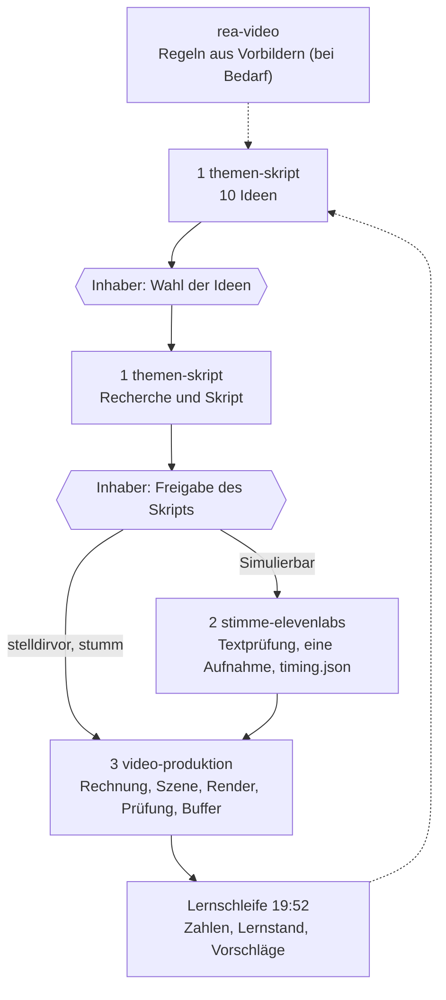

# Pipeline und Skills

Der Weg von der Idee zum geposteten Video, seit 09.11.2026 in **drei Skills in fester Reihenfolge** ([[Entscheidungen Log]]). `rea-video` liefert daneben Regeln aus Vorbildern, die Lernschleife schließt den Kreis. **Das Hirn enthält die Regeln, die Skills den Ablauf und das Ausgabeformat.** Die beiden Accounts bleiben in jedem Schritt getrennt ([[Trennung der Accounts]]).

## Die Kette

Der Inhaber klickt an genau zwei Stellen: **Wahl der Ideen** und **Freigabe des Skripts**. Alles andere läuft von selbst; Vorschläge der Lernschleife brauchen zusätzlich seine Freigabe, bevor sich eine Regel ändert.

## Die Schritte im Einzelnen
| Schritt | Nimmt | Tut | Übergibt | Dateien und Befehle |
|---|---|---|---|---|
| **1 `themen-skript`** (Ideen) | Lernstand (jüngste `Insights`), bisherige Videos (`data/produktion/protokoll.csv`), Regeln des Accounts | erhebt Nachfrage, streicht das Naheliegende, sucht je Fund einen Winkel, prüft Originalität, bewertet | 10 Ideen-Karten, dann „Welche wählst du?“ | Auftragstext aus `tools/chat_befehle.py`; im Cockpit Automatik „Ideen jeden Morgen“ (07:00) |
| **1 `themen-skript`** (Skript) | gewählte Idee | prüft jede Zahl an der Quelle, legt Frage, Auflösung und zweite Frage fest, schreibt das Skript, Selbstprüfung | Skript mit Status „wartet auf Freigabe“ | Cockpit-Automatik „Recherche nach Wahl“; nach Freigabe `pipeline/projekte/<name>/skript.json` |
| **2 `stimme-elevenlabs`** (nur Simulierbar) | freigegebenes Skript | fasst den Sprechtext ins Textformat, kostenlose Textprüfung, **genau eine** Aufnahme | `audio/stimme.mp3`, `audio/timing.json`, Eintrag in `audio/aufnahmen.json` | `python3 qc/stimme_vorab.py projekte/<name>` bis „BEREIT“, dann `python3 tts.py projekte/<name>`; Aussprache in `pipeline/aussprache.json` |
| **3 `video-produktion`** | Skript, bei Simulierbar die fertige Stimme | Rechnung als Code mit Test, Szene in three.js (bei Bedarf 1–2 Blender-Schlüsselszenen), Standbilder, Render auf dem PC, Prüfung, Buffer, Nachprüfung | geplantes bzw. gepostetes Video, `lern_notizen`, Protokollzeile | `sim/<thema>.mjs`, `szene.js`, `render.js`, `mux.sh`, `qc/massstab.py` (A1) bzw. `qc/referenz_pov.py` (A2), `post_buffer.py`; Cockpit-Automatik „Produktion nach Freigabe“ |
| **`rea-video`** (bei Bedarf) | Vorbild-Videos, die der Inhaber hochlädt | zerlegt und misst sie, leitet Regeln ab | Regel-Entwürfe in `04-Recherche`, gültig erst nach Freigabe | [[REA-Video Methode]] |
| **Lernschleife** | Zahlen der eigenen Videos, `lern_notizen` | wertet täglich 19:52 aus, schreibt den Lernstand fort | `Insights JJJJ-MM-TT`, Vorschläge zur Freigabe | [[Lernschleife und Insights]] |

Die Zeiten der Phasen im Video kommen bei Simulierbar aus `audio/timing.json`: Das Video folgt der fertigen Stimme. Regeln zum Sprechtempo gibt es seit 09.11.2026 nicht mehr.

## Wo was liegt
| Skill | Ort | Hirn-Abteil (Regeln) |
|---|---|---|
| `themen-skript` | `.claude/skills/themen-skript/` (`SKILL.md`, `simulierbar.md`, `stelldirvor.md`) | `02-Simulierbar/1-Skripterstellung` ([[Themenfindung Simulierbar]], [[Skriptaufbau Simulierbar]], [[Finanzregeln Simulierbar]], [[Finanz-Formulierungen Simulierbar]]) · `03-stelldirvor-pov/1-Skripterstellung` ([[Themenfindung stelldirvor]], [[Ablauf Account 2]], [[Themen und Plan Account 2]]) |
| `stimme-elevenlabs` | `.claude/skills/stimme-elevenlabs/` (`SKILL.md`) | `02-Simulierbar/2-Stimme` ([[Stimme ElevenLabs Simulierbar]]); Account 2 ist stumm und hat kein Abteil „Stimme“ |
| `video-produktion` | `.claude/skills/video-produktion/` (`SKILL.md`, `simulierbar.md`, `stelldirvor.md`, `technik.md`) | `02-Simulierbar/3-Produktion` ([[Videoaufbau Simulierbar]] und weitere) · `03-stelldirvor-pov/3-Produktion` ([[Design Account 2]] und weitere) |
| `rea-video` | `.claude/skills/rea-video/` | `04-Recherche` ([[REA Simulierbar Regelwerk]], [[REA stelldirvor Regelwerk]], [[REA Übergreifend]]) |

## Technik der Produktion (Entscheidung 09.11.2026)
three.js ist der Kern beider Accounts. Blender ohne Oberfläche rendert bei Bedarf 1–2 realistische Schlüsselszenen je Video. Remotion ist nur als Probelauf an einem fertigen Projekt freigegeben. Einzelheiten: `.claude/skills/video-produktion/technik.md`, [[Technik und Umgebung]].

## Rangfolge bei Widerspruch
Jüngste Entscheidung des Inhabers ([[Entscheidungen Log]]) > REA-Regelwerk des Accounts > Regelwerk des Accounts > Detail-Notizen > [[Maßstab Simulierbar]] (Archiv, Messgrundlage). Ein Widerspruch wird gemeldet, nie still aufgelöst. Kein Skill ändert Regeln.

## Siehe auch
[[Claude-Chat-Workflow]] (Tagesablauf) · [[Cockpit]] · [[Video-Register]] (alle Videos mit Stand und Zahlen, vom Cockpit erzeugt) · [[Produktion Rhythmus und Modelle]] · [[Originalität und Themenfindung]] · [[Wie dieses Hirn funktioniert]] · [[Index]]
